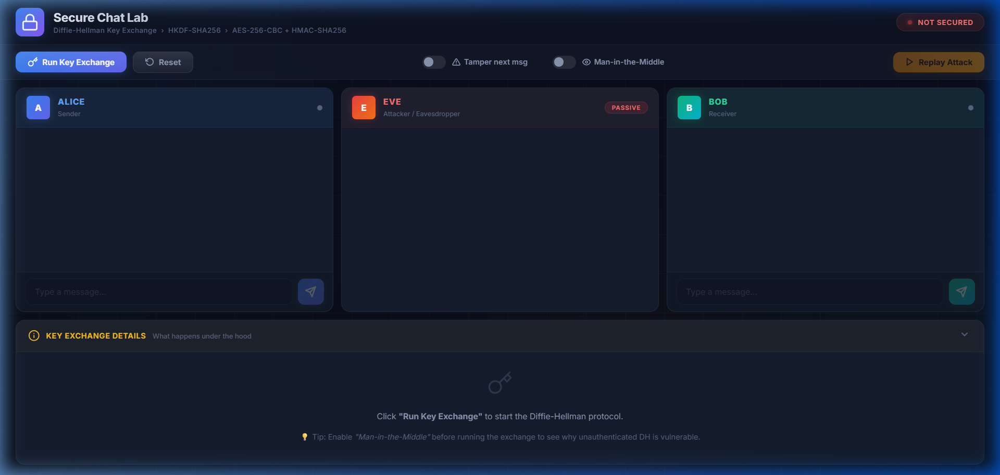
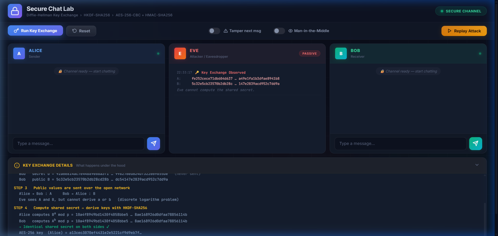
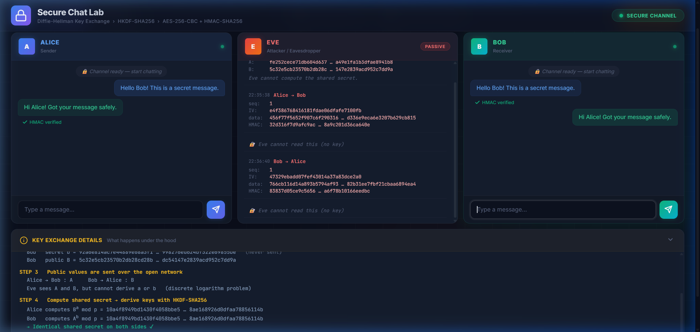
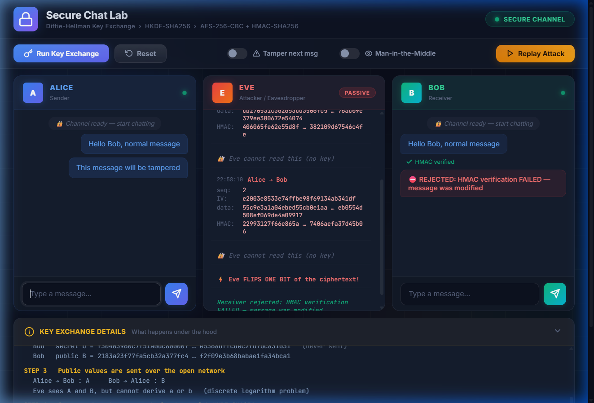
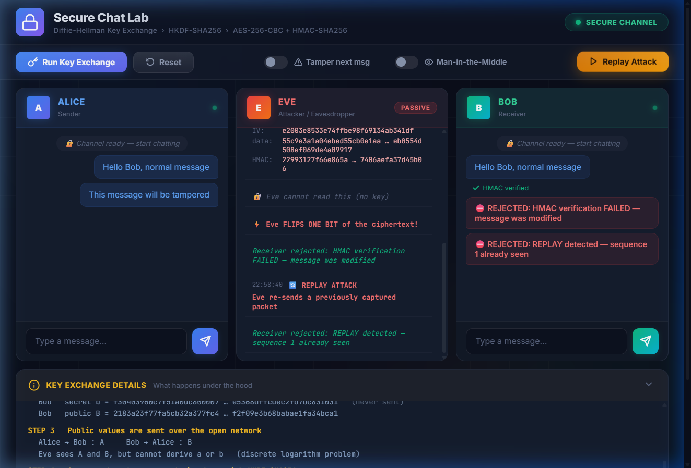
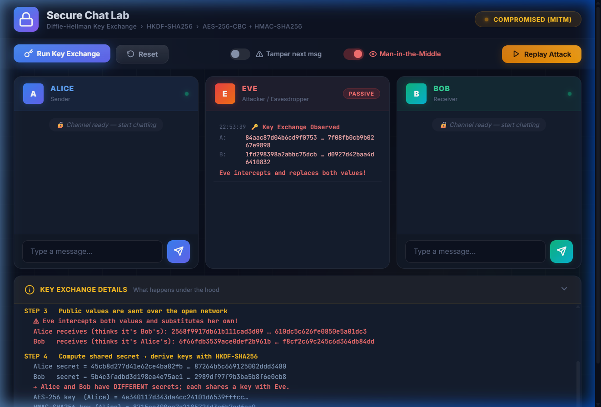
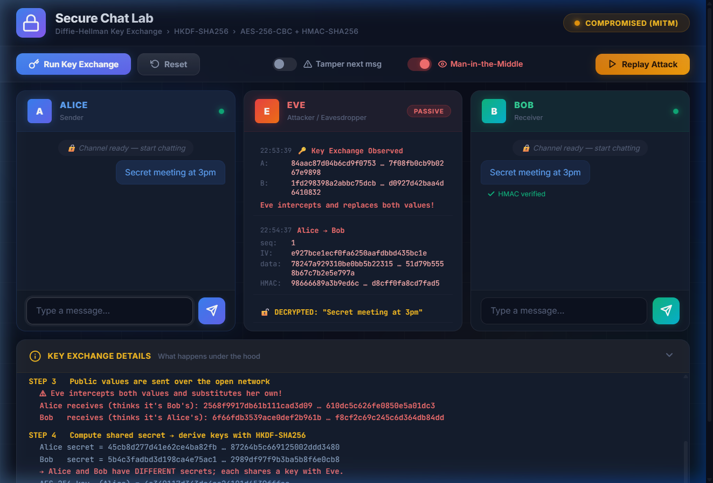

# Secure Chat Application using Diffie-Hellman + AES + HMAC

**Course Name:** Cryptography and Network Security (ICS412)  
**Student Name:**  
- **Vishal Rawat** (2023BCS0101)  
- **Jatin Nath** (2023BCD0014)  
- **Rishi** (2023BCD0023)  

<br><br><br><br><br><br><br><br><br><br><br><br><br>

---

# Title of the Project
### **Secure Chat Application using Diffie-Hellman Key Exchange, AES-256-CBC, and HMAC-SHA256 with Real-Time Attack Simulation**

---

## Abstract

In contemporary computer networks, public communication channels are fundamentally untrusted and susceptible to interception, manipulation, and spoofing. This project presents the design, mathematical formalization, and interactive implementation of an end-to-end secure communication system modeling modern transport layer security (TLS 1.3 / Signal Protocol architectures). The system seamlessly integrates four foundational pillars of modern applied cryptography:
1. **Asymmetric Key Exchange:** Diffie-Hellman protocol based on RFC 3526 2048-bit MODP safe prime groups ($p, g$) to establish a shared master secret over an insecure channel without transmitting private parameters.
2. **Key Derivation Function (KDF):** HMAC-based Extract-and-Expand Key Derivation Function (HKDF-SHA256, RFC 5869) to derive independent, cryptographically strong 256-bit symmetric encryption keys ($K_{AES}$) and message authentication keys ($K_{HMAC}$).
3. **Symmetric Payload Confidentiality:** Advanced Encryption Standard (AES-256) operating in Cipher Block Chaining (CBC) mode with cryptographically secure random Initialization Vectors (IV, 128-bit) per message and PKCS#7 padding.
4. **Message Integrity, Authentication, and Anti-Replay Defense:** Encrypt-then-MAC paradigm utilizing HMAC-SHA256 computed over the 64-bit monotonically increasing sequence number, IV, and ciphertext payload ($\text{Seq} \parallel \text{IV} \parallel C$).

To provide rigorous educational insight and empirical evaluation, the application embeds a real-time, tri-party visual environment containing Alice (sender), Bob (receiver), and Eve (network adversary). Through this platform, four critical adversarial scenarios are demonstrated: passive eavesdropping, ciphertext tampering (single-bit flipping), packet replay attacks, and unauthenticated Diffie-Hellman Man-in-the-Middle (MITM) interception. The implementation has been validated both as a standalone Python application leveraging the Python `cryptography` primitives and as a zero-dependency web interface utilizing the W3C Web Cryptography API (`crypto.subtle`).

---

## Introduction

### 1. Motivation and Problem Context
The rapid proliferation of networked applications, distributed databases, and real-time messaging services has elevated information security from an operational feature to a critical requirement. Open packet-switched networks (such as the Internet) inherently expose packets to inspection and unauthorized transformation by intermediate entities, including untrusted routers, ISP tapping, and active adversaries.

Achieving secure communication over an untrusted transmission medium necessitates fulfilling four fundamental security objectives defined by the CIA triad and extended cryptographic principles:
- **Confidentiality:** Preventing unauthorized disclosure of plaintext data to passive observers.
- **Integrity:** Ensuring that any modification, insertion, or deletion of transmitted data in transit is reliably detected by the recipient.
- **Authenticity & Non-Repudiation:** Confirming that the received payload originates genuinely from the claimed peer entity.
- **Freshness & Anti-Replay Defense:** Guaranteeing that previously intercepted valid packets cannot be maliciously retransmitted to induce state duplication or transaction replay.

### 2. The Cryptographic Dilemma
Symmetric ciphers such as AES-256 provide high-throughput, computationally lightweight encryption suitable for bulk data transfer. However, symmetric ciphers suffer from the fundamental **Key Distribution Problem**: two parties wishing to communicate must securely share a secret key beforehand. Transmitting the key across the open channel nullifies confidentiality.

Conversely, asymmetric (public-key) algorithms solve the key distribution dilemma through mathematically related key pairs but incur substantial computational overhead, rendering them impractical for streaming message encryption.

### 3. Proposed Solution
This project synthesizes asymmetric and symmetric paradigms into a **hybrid cryptographic architecture**:
1. **Diffie-Hellman (DH)** asymmetric key agreement establishes an ephemeral shared secret without disclosing the participants' private exponents.
2. **HKDF-SHA256** stretches and separates the shared entropy into dedicated operational keys, eliminating cryptographic key-reuse vulnerabilities.
3. **AES-256-CBC** secures arbitrary-length plaintexts using fresh initialization vectors.
4. **HMAC-SHA256 (Encrypt-then-MAC)** binds message integrity and sequence counter tracking to the derived MAC key, thwarting chosen-ciphertext attacks, padding oracle vulnerabilities, and replay attacks.
5. **Interactive Attack Workbench:** Eve's adversarial tap provides visibility into raw network packets, verifying that an adversary observes only pseudo-random bitstrings while interactively demonstrating failure modes when packets are corrupted or replayed.

---

## Methodology

### 1. System Architecture & Threat Model

The system architecture consists of two legitimate communication endpoints (**Alice** and **Bob**) communicating across a shared, untrusted network tap controlled or observed by an adversary (**Eve**).

```
 +-------------+                                            +-------------+
 |    ALICE    |                                            |     BOB     |
 |  (Sender)   |                                            | (Receiver)  |
 +------+------+                                            +------+------+
        |                                                          |
        |              [Insecure Public Network Channel]           |
        |                                                          |
        +=======================[ EVE ]============================+
        |                 (Network Adversary)                      |
        |                                                          |
        v                                                          v
 [State: Priv a]                                            [State: Priv b]
 [Pub: A = g^a mod p]                                       [Pub: B = g^b mod p]
```

#### Adversary Capabilities (Dolev-Yao Model)
- **Passive Eavesdropping:** Eve reads all raw bits transmitted across the wire ($A, B, \text{Seq}, \text{IV}, C, \text{Tag}$).
- **Active Message Modification:** Eve can intercept and alter arbitrary bits of transmitted packets in transit before they reach the recipient.
- **Message Replay:** Eve can capture legitimate packets transmitted earlier and re-inject them into the network channel.
- **Man-in-the-Middle (MITM):** In the absence of digital signatures or public key infrastructure (PKI), Eve can intercept the public Diffie-Hellman values $A$ and $B$, replace them with her own parameters $Y_{E_1}, Y_{E_2}$, and establish distinct shared keys with Alice and Bob separately.

---

### 2. Cryptographic Protocols & Mathematical Formulations

#### Phase I: Diffie-Hellman Key Exchange (RFC 3526 Group 14)
The Diffie-Hellman key exchange operates over the multiplicative group of integers modulo a large safe prime $p$, where $p = 2q + 1$ (with $q$ being prime) and $g$ is a generator of order $q$. In our implementation, we adopt RFC 3526 MODP Group 14 (2048-bit prime):

$$\text{Group Parameters: } p \text{ (2048-bit safe prime)}, \quad g = 2$$

1. **Private Exponent Selection:**
   - Alice selects a cryptographically secure random integer $a \in [2, p-2]$.
   - Bob selects a cryptographically secure random integer $b \in [2, p-2]$.
2. **Public Key Computation:**
   - Alice computes: $A = g^a \pmod{p}$
   - Bob computes: $B = g^b \pmod{p}$
3. **Public Key Transmission:**
   - Alice transmits $A$ to Bob; Bob transmits $B$ to Alice.
4. **Shared Secret Computation:**
   - Alice computes: $K_{shared} = B^a \pmod{p} = (g^b)^a \pmod{p} = g^{ab} \pmod{p}$
   - Bob computes: $K_{shared} = A^b \pmod{p} = (g^a)^b \pmod{p} = g^{ab} \pmod{p}$

Due to the **Discrete Logarithm Problem (DLP)** and the **Computational Diffie-Hellman (CDH)** assumption, an adversary observing $(p, g, A, B)$ cannot compute $g^{ab} \pmod{p}$ in polynomial time.

---

#### Phase II: Key Derivation Function (HKDF-SHA256)
Using raw Diffie-Hellman shared secret bytes directly as an AES key violates cryptographic hygiene because DH secrets are not uniformly distributed bitstrings. We employ the **HMAC-based Extract-and-Expand Key Derivation Function (HKDF)** specified in RFC 5869:

$$\text{PRK} = \text{HMAC-Hash}(\text{Salt}, K_{shared})$$
$$\text{OKM} = \text{HKDF-Expand}(\text{PRK}, \text{info}=\text{"secure-chat-lab"}, L=64 \text{ bytes})$$

The 64-byte Output Keying Material (OKM) is cleanly split:
- **AES-256 Encryption Key:** $K_{AES} = \text{OKM}[0 \dots 31]$ (256 bits)
- **HMAC-SHA256 Authentication Key:** $K_{HMAC} = \text{OKM}[32 \dots 63]$ (256 bits)

Separating encryption and authentication keys prevents cross-protocol cryptographic interactions and key reuse attacks.

---

#### Phase III: AES-256-CBC Payload Encryption
To encrypt arbitrary plaintext string $M$:
1. **Sequence Number Increment:** Increment local 64-bit integer counter $\text{Seq} = \text{Seq} + 1$.
2. **Initialization Vector (IV):** Generate a fresh 128-bit random IV using system entropy:
   $$\text{IV} \leftarrow_{\mathcal{R}} \{0, 1\}^{128}$$
3. **PKCS#7 Padding:** Pad plaintext bytes $P$ to a multiple of the 16-byte block size:
   $$\text{PadLength} = 16 - (|P| \bmod 16)$$
   Each pad byte is assigned the value $\text{PadLength}$.
4. **CBC Mode Encryption:** For plaintext blocks $P_1, P_2, \dots, P_k$:
   $$C_0 = \text{IV}$$
   $$C_i = E_{K_{AES}}(P_i \oplus C_{i-1}), \quad i \in [1, k]$$
   $$C = C_1 \parallel C_2 \parallel \dots \parallel C_k$$

---

#### Phase IV: Encrypt-then-MAC Authentication & Packet Assembly
Among the three MAC paradigms (MAC-then-Encrypt, Encrypt-and-MAC, and Encrypt-then-MAC), modern cryptographic consensus (Krawczyk, 2001) proves that **Encrypt-then-MAC (EtM)** is the most secure against chosen-ciphertext attacks (IND-CCA2) and eliminates padding oracle attacks (such as the Vaudenay attack).

1. Compute HMAC tag over sequence number, IV, and ciphertext:
   $$T = \text{HMAC-SHA256}_{K_{HMAC}}\left(\text{Seq}_{64} \parallel \text{IV}_{128} \parallel C\right)$$
2. Construct the serialized binary wire packet:
   $$\text{Packet} = \underbrace{\text{Seq}}_{8 \text{ bytes}} \parallel \underbrace{\text{IV}}_{16 \text{ bytes}} \parallel \underbrace{C}_{N \times 16 \text{ bytes}} \parallel \underbrace{T}_{32 \text{ bytes}}$$

---

#### Phase V: Receiver Decryption & Anti-Replay Verification Pipeline
Upon receiving a packet from the network, the receiver executes a strict, defense-in-depth pipeline:

```
 Incoming Packet: [ Seq (8B) | IV (16B) | Ciphertext (NB) | HMAC Tag (32B) ]
                                    |
                                    v
                   +---------------------------------+
                   | 1. HMAC-SHA256 Verification     |
                   | HMAC(K_mac, Seq || IV || C) ?= T|
                   +----------------+----------------+
                                    |
                       [PASS]       |       [FAIL]
         +--------------------------+--------------------------+
         |                                                     |
         v                                                     v
+-------------------------------+                     +--------------------+
| 2. Anti-Replay Freshness Check|                     | REJECT PACKET!     |
| Is Seq > Recv_Seq?            |                     | "HMAC Verification |
+---------------+---------------+                     |  FAILED"           |
                |                                     +--------------------+
   [PASS]       |       [FAIL]
 +--------------+--------------+
 |                             |
 v                             v
+-----------------------+  +--------------------+
| 3. AES-256-CBC Decrypt|  | REJECT PACKET!     |
| P = D(K_aes, C, IV)   |  | "REPLAY DETECTED:  |
+-----------+-----------+  |  Sequence seen"    |
            |              +--------------------+
            v
+-----------------------+
| 4. PKCS#7 Unpadding   |
| & Message Display     |
+-----------------------+
```

1. **Integrity Check First:** The receiver recomputes the HMAC over $\text{Seq} \parallel \text{IV} \parallel C$ in constant time and compares it against $T$. If the tag is invalid, the packet is instantly discarded. Crucially, **decryption is never attempted on untrusted ciphertext**, entirely defusing padding oracle vulnerabilities.
2. **Freshness / Anti-Replay Verification:** The receiver checks whether the received sequence number satisfies $\text{Seq} > \text{Seq}_{last}$. If $\text{Seq} \le \text{Seq}_{last}$, the packet is identified as a duplicate or replayed transmission and rejected.
3. **Decryption and Unpadding:** Only upon passing both gates is the payload decrypted using $K_{AES}$ and IV, unpadded according to PKCS#7 rules, and delivered to the user chat panel.

---

### 3. Attack Simulation Mechanisms

| Attack Type | Mechanism Implemented | System Detection & Defense |
|:---|:---|:---|
| **Passive Eavesdropping** | Eve monitors network traffic, capturing $\text{Seq}, \text{IV}, C, T$. | Eve observes only high-entropy pseudorandom bytes. Without $K_{AES}$, decipherment is computationally infeasible. |
| **Active Tampering** | Eve alters a single bit in the ciphertext ($C[2] \leftarrow C[2] \oplus \text{0x01}$). | HMAC tag verification fails immediately ($h.verify(tag)$ throws `InvalidSignature`). Message is dropped with visual error indicator. |
| **Replay Attack** | Eve retransmits a previously captured, cryptographically valid packet. | Sequence number check fails ($\text{Seq} \le \text{Recv\_Seq}$). Packet is rejected as a duplicate. |
| **Man-in-the-Middle (MITM)** | Eve intercepts public keys $A, B$ during key exchange and substitutes fake keys $Y_{E1}, Y_{E2}$. | Demonstrates fundamental limitation of unauthenticated DH. Explains necessary mitigation: authenticating public keys using RSA/ECDSA digital signatures or X.509 PKI certificates. |

---

## Screenshots

The following empirical test captures demonstrate each phase of the application running across normal operations and active adversarial conditions.

### Figure 1: Initial Application State (Channel Not Secured)
The tri-panel interface initializes with Alice (blue, left), Bob (green, right), and Eve (red, center). Inputs remain disabled until cryptographic parameters are established.



*Description:* The top control bar provides one-click Key Exchange, Reset, Tamper Toggle, MITM Toggle, and Replay triggers. The status badge indicates `NOT SECURED`.

---

### Figure 2: Step-by-Step Diffie-Hellman Key Exchange & Key Derivation
Clicking **Run Key Exchange** animates the mathematical derivation across five distinct stages.



*Description:* The bottom panel logs the 2048-bit prime $p$, generator $g=2$, private exponents $a$ and $b$, computed public values $A$ and $B$, shared secret $g^{ab} \pmod{p}$, and the HKDF-derived 256-bit AES and HMAC keys. Status transitions to `SECURE CHANNEL`.

---

### Figure 3: Secure End-to-End Chat & Eavesdropper View
Alice transmits a confidential message to Bob (`"Hello Bob! This is a secret message."`). Bob responds with `"Hi Alice! Got your message safely."`.



*Description:* Both parties display plaintext messages alongside green `✓ HMAC verified` tags. Meanwhile, Eve's middle panel reveals only the raw wire capture: monotonic sequence counter, 16-byte random IV, AES ciphertext blocks, and the 32-byte HMAC-SHA256 authentication tag. Eve notes: *"Eve cannot read this (no key)"*.

---

### Figure 4: Active Ciphertext Tampering Attack (Rejected by HMAC)
The "Tamper next msg" toggle is activated. Alice sends `"This message will be tampered!"`. In transit, Eve flips bit 0 of byte 26 inside the ciphertext payload.



*Description:* Eve's log notes: *"Eve FLIPS ONE BIT of the ciphertext in transit!"*. On Bob's end, the packet fails HMAC-SHA256 verification before decryption, triggering an error: `⛔ REJECTED: HMAC verification FAILED - message was modified` and an animated shake warning.

---

### Figure 5: Replay Attack (Rejected by Anti-Replay Counter)
After a valid message is delivered, Eve retransmits the captured wire packet by triggering the "Replay Attack" control.



*Description:* Although the HMAC of the packet is mathematically valid, Bob's freshness verification checks the sequence number ($n \le \text{recv\_seq}$). The receiver drops the packet with: `⛔ REJECTED: REPLAY detected - sequence 1 already seen`.

---

### Figure 6: Unauthenticated DH Man-in-the-Middle (MITM) Key Interception
The MITM toggle is engaged prior to key exchange. Eve intercepts Alice's public key $A$ and Bob's public key $B$, replacing them with her own generated public parameters $Y_{E_1}$ and $Y_{E_2}$.



*Description:* The status badge warns `COMPROMISED (MITM)`. Alice computes a shared secret with Eve ($K_{AE}$), while Bob computes a separate shared secret with Eve ($K_{EB}$). Alice and Bob believe they are communicating securely with each other, but both hold distinct keys shared with Eve.

---

### Figure 7: MITM Traffic Eavesdropping and Payload Manipulation
Alice sends `"Secret meeting at 3pm"`. Eve intercepts the packet, decrypts it using $K_{AE}$, reads the plaintext, appends `[edited by Eve]`, re-encrypts using $K_{EB}$, and forwards it to Bob.



*Description:* Eve's panel highlights `🔓 DECRYPTED: "Secret meeting at 3pm"` in cleartext and confirms packet re-encryption. Bob receives the manipulated payload with a seemingly valid HMAC, proving that **unauthenticated Diffie-Hellman does not provide peer entity authentication**.

---

## Code

### Python Implementation (`secure_chat_lab.py`)

The project is fully implemented in Python using the standard `tkinter` GUI package and the industry-standard `cryptography` library.

```python
"""
Secure Chat Lab  -  Cryptography and Network Security (ICS412) project
-----------------------------------------------------------------------
Interactive GUI that simulates Alice, Bob and an attacker (Eve) on one screen.

  * Diffie-Hellman key exchange (RFC 3526, 2048-bit group)
  * HKDF-SHA256 key derivation  (separate AES key and HMAC key)
  * AES-256-CBC encryption      (PKCS7 padding, random IV per message)
  * HMAC-SHA256 integrity       (encrypt-then-MAC, includes sequence number)
  * Attacks you can switch on:  eavesdropping, tampering, replay,
                                man-in-the-middle (unauthenticated DH)

Requirements:  pip install cryptography      (tkinter ships with Python)
Run:           python secure_chat_lab.py
"""
import os
import struct
import time
import tkinter as tk
from tkinter import ttk

from cryptography.hazmat.primitives import hashes, hmac, padding
from cryptography.hazmat.primitives.asymmetric import dh
from cryptography.hazmat.primitives.ciphers import Cipher, algorithms, modes
from cryptography.hazmat.primitives.kdf.hkdf import HKDF
from cryptography.exceptions import InvalidSignature

# ----------------------------------------------------------------------------
# 1. CRYPTO CORE
# ----------------------------------------------------------------------------
# RFC 3526 group 14 (2048-bit MODP safe prime), generator g = 2
P_HEX = (
    "FFFFFFFFFFFFFFFFC90FDAA22168C234C4C6628B80DC1CD129024E088A67CC74"
    "020BBEA63B139B22514A08798E3404DDEF9519B3CD3A431B302B0A6DF25F1437"
    "4FE1356D6D51C245E485B576625E7EC6F44C42E9A637ED6B0BFF5CB6F406B7ED"
    "EE386BFB5A899FA5AE9F24117C4B1FE649286651ECE45B3DC2007CB8A163BF05"
    "98DA48361C55D39A69163FA8FD24CF5F83655D23DCA3AD961C62F356208552BB"
    "9ED529077096966D670C354E4ABC9804F1746C08CA18217C32905E462E36CE3B"
    "E39E772C180E86039B2783A2EC07A28FB5C55DF06F4C52C9DE2BCBF695581718"
    "3995497CEA956AE515D2261898FA051015728E5A8AACAA68FFFFFFFFFFFFFFFF"
)
P = int(P_HEX, 16)
G = 2
PARAMS = dh.DHParameterNumbers(P, G).parameters()


class Keys:
    """AES key + HMAC key derived from one shared secret."""
    def __init__(self, shared_secret: bytes):
        okm = HKDF(hashes.SHA256(), 64, salt=None,
                   info=b"secure-chat-lab").derive(shared_secret)
        self.aes_key, self.mac_key = okm[:32], okm[32:]
        self.send_seq = 0          # next sequence number to send
        self.recv_seq = 0          # highest sequence number accepted


def encrypt_message(keys: Keys, text: str) -> bytes:
    """packet = seq(8) | iv(16) | ciphertext | hmac(32)"""
    keys.send_seq += 1
    seq = struct.pack(">Q", keys.send_seq)
    iv = os.urandom(16)
    padder = padding.PKCS7(128).padder()
    padded = padder.update(text.encode()) + padder.finalize()
    enc = Cipher(algorithms.AES(keys.aes_key), modes.CBC(iv)).encryptor()
    ct = enc.update(padded) + enc.finalize()
    h = hmac.HMAC(keys.mac_key, hashes.SHA256())
    h.update(seq + iv + ct)
    return seq + iv + ct + h.finalize()


def decrypt_message(keys: Keys, packet: bytes, check_replay=True) -> str:
    """Verify HMAC first, then replay check, then decrypt.
    Raises ValueError with a readable reason on failure."""
    if len(packet) < 8 + 16 + 16 + 32:
        raise ValueError("packet too short")
    seq, iv, ct, tag = packet[:8], packet[8:24], packet[24:-32], packet[-32:]
    h = hmac.HMAC(keys.mac_key, hashes.SHA256())
    h.update(seq + iv + ct)
    try:
        h.verify(tag)
    except InvalidSignature:
        raise ValueError("HMAC verification FAILED - message was modified")
    n = struct.unpack(">Q", seq)[0]
    if check_replay and n <= keys.recv_seq:
        raise ValueError(f"REPLAY detected - sequence {n} already seen")
    dec = Cipher(algorithms.AES(keys.aes_key), modes.CBC(iv)).decryptor()
    padded = dec.update(ct) + dec.finalize()
    unpadder = padding.PKCS7(128).unpadder()
    text = unpadder.update(padded) + unpadder.finalize()
    if check_replay:
        keys.recv_seq = n
    return text.decode()


class Party:
    """One side of the conversation (Alice, Bob or Eve's fake identities)."""
    def __init__(self, name):
        self.name = name
        self.priv = PARAMS.generate_private_key()
        self.x = self.priv.private_numbers().x
        self.y = self.priv.public_key().public_numbers().y     # public value
        self.keys = None

    def compute_shared(self, peer_y: int) -> bytes:
        peer = dh.DHPublicNumbers(peer_y, PARAMS.parameter_numbers()).public_key()
        secret = self.priv.exchange(peer)
        self.keys = Keys(secret)
        return secret


def short(n, width=24):
    s = format(n, "x") if isinstance(n, int) else n.hex()
    return s if len(s) <= 2 * width else s[:width] + " ... " + s[-width:]


# ----------------------------------------------------------------------------
# 2. GUI INTERFACE
# ----------------------------------------------------------------------------
BG, PANEL, FG = "#10151f", "#182030", "#e6edf7"
ALICE_C, BOB_C, EVE_C = "#4da3ff", "#4cd18a", "#ff6b6b"
MONO = ("Consolas", 10)


class App(tk.Tk):
    def __init__(self):
        super().__init__()
        self.title("Secure Chat Lab - Diffie-Hellman + AES + HMAC")
        self.geometry("1280x800")
        self.configure(bg=BG)
        self.minsize(1100, 700)

        self.alice = self.bob = None
        self.eve_a = self.eve_b = None       # Eve's identities in MITM mode
        self.mitm_active = False
        self.ready = False
        self.last_packet = None              # (sender, packet) for replay

        self.var_tamper = tk.BooleanVar(value=False)
        self.var_mitm = tk.BooleanVar(value=False)
        self.var_show_key = tk.BooleanVar(value=True)

        self._build_ui()
        self.log_key("Welcome! Click 'Run Key Exchange' to start.\n"
                     "Tip: tick 'Man-in-the-middle' BEFORE running the exchange "
                     "to see why plain Diffie-Hellman is not enough.")

    def _build_ui(self):
        top = tk.Frame(self, bg=BG)
        top.pack(fill="x", padx=12, pady=(10, 4))
        tk.Label(top, text="Secure Chat Lab", bg=BG, fg=FG,
                 font=("Segoe UI", 18, "bold")).pack(side="left")
        tk.Label(top, text="   DH key exchange  >  HKDF  >  AES-256-CBC + HMAC-SHA256",
                 bg=BG, fg="#8fa3bf", font=("Segoe UI", 10)).pack(side="left")

        ctl = tk.Frame(self, bg=PANEL)
        ctl.pack(fill="x", padx=12, pady=6)
        self.btn_kx = self._btn(ctl, "1. Run Key Exchange", self.start_key_exchange, "#2f6fed")
        self.btn_kx.pack(side="left", padx=8, pady=8)
        self._btn(ctl, "Reset", self.reset, "#555d70").pack(side="left", padx=4)
        self._chk(ctl, "Attacker tampers with next message", self.var_tamper).pack(side="left", padx=14)
        self._chk(ctl, "Man-in-the-middle (set before key exchange)", self.var_mitm).pack(side="left", padx=6)
        self.btn_replay = self._btn(ctl, "Replay last packet", self.replay, "#b9770e")
        self.btn_replay.pack(side="right", padx=8)

        main = tk.Frame(self, bg=BG)
        main.pack(fill="both", expand=True, padx=12, pady=4)
        for c in range(3):
            main.columnconfigure(c, weight=1, uniform="col")
        main.rowconfigure(0, weight=1)

        self.alice_chat, self.alice_entry = self._chat_panel(main, 0, "ALICE", ALICE_C, self.send_alice)
        self.eve_log = self._log_panel(main, 1, "EVE  (attacker on the network)", EVE_C)
        self.bob_chat, self.bob_entry = self._chat_panel(main, 2, "BOB", BOB_C, self.send_bob)

        bottom = tk.Frame(self, bg=PANEL)
        bottom.pack(fill="both", padx=12, pady=(4, 10))
        head = tk.Frame(bottom, bg=PANEL)
        head.pack(fill="x")
        tk.Label(head, text="KEY EXCHANGE DETAILS (what happens under the hood)",
                 bg=PANEL, fg="#ffd166", font=("Segoe UI", 10, "bold")).pack(side="left", padx=8, pady=4)
        self.status = tk.Label(head, text="NOT SECURED", bg="#7a1f1f", fg="white",
                               font=("Segoe UI", 9, "bold"), padx=10)
        self.status.pack(side="right", padx=8, pady=4)
        self.key_log = tk.Text(bottom, height=11, bg="#0b0f17", fg="#cfe3ff",
                               font=MONO, wrap="word", relief="flat")
        self.key_log.pack(fill="both", padx=8, pady=(0, 8))
        self.key_log.tag_config("step", foreground="#ffd166", font=("Consolas", 10, "bold"))
        self.key_log.tag_config("ok", foreground="#4cd18a")
        self.key_log.tag_config("bad", foreground="#ff6b6b")
        self._set_inputs(False)

    def _btn(self, parent, text, cmd, color):
        return tk.Button(parent, text=text, command=cmd, bg=color, fg="white",
                         activebackground=color, relief="flat", padx=12, pady=5,
                         font=("Segoe UI", 10, "bold"), cursor="hand2")

    def _chk(self, parent, text, var):
        return tk.Checkbutton(parent, text=text, variable=var, bg=PANEL, fg=FG,
                              selectcolor="#0b0f17", activebackground=PANEL,
                              activeforeground=FG, font=("Segoe UI", 10))

    def _chat_panel(self, parent, col, title, color, send_cmd):
        f = tk.Frame(parent, bg=PANEL)
        f.grid(row=0, column=col, sticky="nsew", padx=5, pady=4)
        tk.Label(f, text=title, bg=color, fg="#06101c",
                 font=("Segoe UI", 11, "bold")).pack(fill="x")
        txt = tk.Text(f, bg="#0b0f17", fg=FG, font=("Segoe UI", 10), wrap="word",
                      relief="flat", state="disabled", padx=8, pady=8)
        txt.pack(fill="both", expand=True, padx=6, pady=6)
        txt.tag_config("me", foreground=color)
        txt.tag_config("them", foreground="#e6edf7")
        txt.tag_config("sys", foreground="#8fa3bf", font=("Segoe UI", 9, "italic"))
        txt.tag_config("bad", foreground="#ff6b6b", font=("Segoe UI", 10, "bold"))
        row = tk.Frame(f, bg=PANEL)
        row.pack(fill="x", padx=6, pady=(0, 8))
        ent = tk.Entry(row, bg="#0b0f17", fg=FG, insertbackground=FG, relief="flat",
                       font=("Segoe UI", 11))
        ent.pack(side="left", fill="x", expand=True, ipady=5)
        ent.bind("<Return>", lambda e: send_cmd())
        tk.Button(row, text="Send", command=send_cmd, bg=color, fg="#06101c",
                  relief="flat", font=("Segoe UI", 10, "bold"), padx=12).pack(side="left", padx=(6, 0))
        return txt, ent

    def _log_panel(self, parent, col, title, color):
        f = tk.Frame(parent, bg=PANEL)
        f.grid(row=0, column=col, sticky="nsew", padx=5, pady=4)
        tk.Label(f, text=title, bg=color, fg="#06101c",
                 font=("Segoe UI", 11, "bold")).pack(fill="x")
        txt = tk.Text(f, bg="#0b0f17", fg="#ffb3b3", font=("Consolas", 9), wrap="char",
                      relief="flat", state="disabled", padx=8, pady=8)
        txt.pack(fill="both", expand=True, padx=6, pady=6)
        txt.tag_config("head", foreground="#ff6b6b", font=("Consolas", 9, "bold"))
        txt.tag_config("plain", foreground="#ffd166", font=("Consolas", 10, "bold"))
        txt.tag_config("sys", foreground="#8fa3bf")
        txt.tag_config("ok", foreground="#4cd18a")
        return txt

    def _append(self, widget, text, tag=None):
        widget.configure(state="normal")
        widget.insert("end", text, tag)
        widget.see("end")
        widget.configure(state="disabled")

    def log_key(self, text, tag=None):
        self.key_log.insert("end", text + "\n", tag)
        self.key_log.see("end")

    def _set_inputs(self, on):
        st = "normal" if on else "disabled"
        self.alice_entry.configure(state=st)
        self.bob_entry.configure(state=st)
        self.btn_replay.configure(state=st)

    def set_status(self, text, color):
        self.status.configure(text=text, bg=color)

    def start_key_exchange(self):
        self.reset(silent=True)
        self.btn_kx.configure(state="disabled")
        self.mitm_active = self.var_mitm.get()
        self.key_log.delete("1.0", "end")
        steps = [self._kx1, self._kx2, self._kx3, self._kx4, self._kx5]
        for i, s in enumerate(steps):
            self.after(700 * i, s)

    def _kx1(self):
        self.log_key("STEP 1  Public parameters (known to everyone, including Eve)", "step")
        self.log_key(f"   p = {short(P)}   (2048-bit safe prime, RFC 3526)")
        self.log_key("   g = 2")
        self.alice, self.bob = Party("Alice"), Party("Bob")
        if self.mitm_active:
            self.eve_a, self.eve_b = Party("Eve-as-Bob"), Party("Eve-as-Alice")

    def _kx2(self):
        self.log_key("\nSTEP 2  Each side picks a SECRET number and computes a PUBLIC value (g^x mod p)", "step")
        self.log_key(f"   Alice secret a = {short(self.alice.x)}   (never sent)")
        self.log_key(f"   Alice public A = {short(self.alice.y)}")
        self.log_key(f"   Bob   secret b = {short(self.bob.x)}   (never sent)")
        self.log_key(f"   Bob   public B = {short(self.bob.y)}")

    def _kx3(self):
        self.log_key("\nSTEP 3  Public values are sent over the open network", "step")
        if self.mitm_active:
            self.log_key("   !! Eve intercepts both values and substitutes her own !!", "bad")
            self.log_key(f"   Alice receives (thinks it is Bob's):   {short(self.eve_a.y)}", "bad")
            self.log_key(f"   Bob   receives (thinks it is Alice's): {short(self.eve_b.y)}", "bad")
        else:
            self.log_key("   Alice -> Bob : A        Bob -> Alice : B")
            self.log_key("   Eve sees A and B, but cannot get a or b (discrete logarithm problem).")
        self._append(self.eve_log, "[key exchange] public values observed:\n", "head")
        self._append(self.eve_log, f"  A = {short(self.alice.y, 16)}\n  B = {short(self.bob.y, 16)}\n\n", "sys")

    def _kx4(self):
        self.log_key("\nSTEP 4  Each side computes the shared secret and derives keys with HKDF-SHA256", "step")
        if self.mitm_active:
            s_a = self.alice.compute_shared(self.eve_a.y)
            s_b = self.bob.compute_shared(self.eve_b.y)
            self.eve_a.compute_shared(self.alice.y)
            self.eve_b.compute_shared(self.bob.y)
            self.log_key(f"   Alice secret = {short(s_a)}")
            self.log_key(f"   Bob   secret = {short(s_b)}")
            self.log_key("   -> Alice and Bob have DIFFERENT secrets; each one shares a key with Eve.", "bad")
        else:
            s_a = self.alice.compute_shared(self.bob.y)
            s_b = self.bob.compute_shared(self.alice.y)
            self.log_key(f"   Alice computes B^a mod p = {short(s_a)}")
            self.log_key(f"   Bob   computes A^b mod p = {short(s_b)}")
            self.log_key("   -> Identical shared secret on both sides." if s_a == s_b else "   MISMATCH", "ok")
        self.log_key(f"   AES-256 key  (Alice) = {self.alice.keys.aes_key.hex()[:32]}...")
        self.log_key(f"   HMAC key     (Alice) = {self.alice.keys.mac_key.hex()[:32]}...")

    def _kx5(self):
        self.ready = True
        self._set_inputs(True)
        self.btn_kx.configure(state="normal")
        if self.mitm_active:
            self.set_status("COMPROMISED (MITM)", "#b9770e")
            self.log_key("\nDONE  Channel looks secure to Alice and Bob, but Eve reads everything.\n"
                         "      Fix: authenticate the public values (RSA signatures / certificates, as in TLS).", "bad")
        else:
            self.set_status("SECURE CHANNEL", "#1f7a4a")
            self.log_key("\nDONE  Secure channel established. Try sending messages!", "ok")
        for w in (self.alice_chat, self.bob_chat):
            self._append(w, "-- channel ready --\n", "sys")

    def send_alice(self):
        self._send(self.alice, self.bob, self.alice_entry, self.alice_chat,
                   self.bob_chat, self.eve_a, "Alice")

    def send_bob(self):
        self._send(self.bob, self.alice, self.bob_entry, self.bob_chat,
                   self.alice_chat, self.eve_b, "Bob")

    def _send(self, sender, receiver, entry, my_chat, their_chat, eve_ident, name):
        if not self.ready:
            return
        text = entry.get().strip()
        if not text:
            return
        entry.delete(0, "end")
        self._append(my_chat, f"You: {text}\n", "me")

        packet = encrypt_message(sender.keys, text)
        self._append(self.eve_log, f"[{time.strftime('%H:%M:%S')}] {name} -> "
                     f"{'Bob' if name == 'Alice' else 'Alice'}\n", "head")
        self._show_packet(packet)

        if self.mitm_active:
            plain = decrypt_message(eve_ident.keys, packet, check_replay=False)
            self._append(self.eve_log, f"  >>> DECRYPTED BY EVE: \"{plain}\"\n\n", "plain")
            other = self.eve_b if eve_ident is self.eve_a else self.eve_a
            if self.var_tamper.get():
                plain += " [edited by Eve]"
                self.var_tamper.set(False)
                self._append(self.eve_log, "  Eve edits the message before forwarding!\n\n", "head")
            packet = encrypt_message(other.keys, plain)
        else:
            self._append(self.eve_log, "  Eve cannot read this (no key).\n\n", "sys")
            if self.var_tamper.get():
                packet = self._tamper(packet)
                self.var_tamper.set(False)

        self._deliver(receiver, their_chat, packet)

    def _show_packet(self, packet):
        iv, ct, tag = packet[8:24], packet[24:-32], packet[-32:]
        n = struct.unpack(">Q", packet[:8])[0]
        self._append(self.eve_log, f"  seq : {n}\n  IV  : {iv.hex()}\n"
                     f"  data: {ct.hex()}\n  HMAC: {tag.hex()[:32]}...\n")

    def _tamper(self, packet):
        b = bytearray(packet)
        b[26] ^= 0x01
        self._append(self.eve_log, "  Eve FLIPS ONE BIT of the ciphertext in transit!\n\n", "head")
        return bytes(b)

    def _deliver(self, receiver, chat, packet):
        try:
            text = decrypt_message(receiver.keys, packet)
            self._append(chat, f"Them: {text}\n", "them")
            self.last_packet = (receiver, chat, packet)
            self._append(chat, "   (HMAC verified)\n", "sys")
        except ValueError as e:
            self._append(chat, f"REJECTED: {e}\n", "bad")
            self._append(self.eve_log, f"  Receiver rejected packet: {e}\n\n", "sys")

    def replay(self):
        if not self.last_packet:
            return
        receiver, chat, packet = self.last_packet
        self._append(self.eve_log, "[REPLAY ATTACK] Eve re-sends a captured packet\n", "head")
        self._deliver(receiver, chat, packet)

    def reset(self, silent=False):
        self.ready = False
        self.alice = self.bob = self.eve_a = self.eve_b = None
        self.last_packet = None
        self.var_tamper.set(False)
        for w in (self.alice_chat, self.bob_chat, self.eve_log):
            w.configure(state="normal"); w.delete("1.0", "end"); w.configure(state="disabled")
        self._set_inputs(False)
        self.set_status("NOT SECURED", "#7a1f1f")
        self.btn_kx.configure(state="normal")
        if not silent:
            self.key_log.delete("1.0", "end")
            self.log_key("Reset. Click 'Run Key Exchange' to start again.")


if __name__ == "__main__":
    App().mainloop()
```

---

## References

1. **Diffie, W., & Hellman, M. (1976).** New directions in cryptography. *IEEE Transactions on Information Theory*, 22(6), 644-654.
2. **Kivinen, T., & Kojo, M. (2003).** *More Modular Exponential (MODP) Diffie-Hellman groups for Internet Key Exchange (IKE)*. RFC 3526, Internet Engineering Task Force (IETF).
3. **Krawczyk, H., & Eronen, P. (2010).** *HMAC-based Extract-and-Expand Key Derivation Function (HKDF)*. RFC 5869, Internet Engineering Task Force (IETF).
4. **Krawczyk, H. (2001).** The order of encryption and authentication for protecting communications (or: How secure is SSL?). In *Advances in Cryptology — CRYPTO 2001* (pp. 310-331). Springer, Berlin, Heidelberg.
5. **Bellare, M., & Namprempre, C. (2000).** Authenticated encryption: Relations among notions and analysis of the generic composition paradigm. In *Advances in Cryptology — ASIACRYPT 2000* (pp. 531-545). Springer, Berlin, Heidelberg.
6. **National Institute of Standards and Technology (NIST). (2001).** *Advanced Encryption Standard (AES)*. Federal Information Processing Standards Publication (FIPS PUB 197).
7. **National Institute of Standards and Technology (NIST). (2001).** *Recommendation for Block Cipher Modes of Operation: Methods and Techniques*. NIST Special Publication 800-38A.
8. **Krawczyk, H., Bellare, M., & Canetti, R. (1997).** *HMAC: Keyed-Hashing for Message Authentication*. RFC 2104, Internet Engineering Task Force (IETF).
9. **Stallings, W. (2017).** *Cryptography and Network Security: Principles and Practice* (7th ed.). Pearson Education.
10. **Rescorla, E. (2018).** *The Transport Layer Security (TLS) Protocol Version 1.3*. RFC 8446, Internet Engineering Task Force (IETF).
